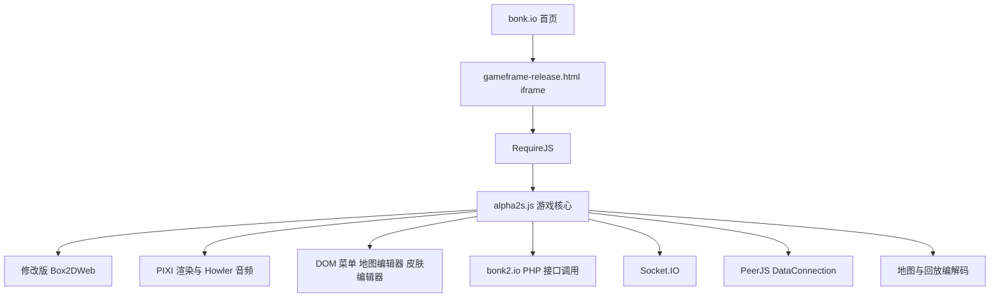

# bonk.io 逆向分析

采样日期：2026-10-13（Asia/Shanghai）。目标：[bonk.io](https://bonk.io/)。

已完成当前公开前端的脚本采集、部分去混淆、物理与联机代码分析，以及游客教程运行核验。成果包含原始脚本、可读分析副本和 REA Evidence；没有恢复服务端源码，也没有交付可独立部署的游戏复刻。

## 核心结论

| 问题 | 结果 | 证据性质与位置 |
|---|---|---|
| 游戏入口在哪里？ | 首页 iframe 加载 `gameframe-release.html`，RequireJS 加载 `js/alpha2s.js`；游戏页直接作为顶层页面访问会跳回首页 | 原始 HTML，`raw/gameframe-release.html:1645`；可读副本第 2 行 |
| 客户端技术栈？ | PIXI legacy、修改版 Box2DWeb、RequireJS、jQuery、Howler、Socket.IO、PeerJS、timesync | REA 浏览器脚本清单；PIXI 控制台显示 `5.4.0-rc.2`、WebGL 2 |
| 核心脚本多大？ | `alpha2s.js` 为 2,699,132 字节；包含字符串编码、算术分派、控制流与校验混淆 | 原始文件及浏览器 source SHA-256 一致 |
| 能恢复多少可读信息？ | 1,724 项属性字典，4,481 个字符串；替换 29,775 处生成 46,365 行可读副本 | 派生脚本自检与 `substitutions.json`；并非作者原始源码 |
| 模拟频率？ | 游戏推进循环使用 `1000 / 30`，约 30 个模拟 tick/s；渲染循环独立 | `game.readable.js:45184`；静态代码，不代表每台设备的实际 FPS |
| 玩家输入是什么格式？ | `left/right/up/down/action/action2` 六个布尔位压入整数；变更时发送 `{i, f}`，通信层追加计数器 `c` | `game.readable.js:42802`、`:45615`、`:15695` |
| 联机通过什么传输？ | 同一输入先 Socket.IO `emit`，再发送至已打开的 PeerJS DataConnection；Peer 服务配置 443、`/myapp`、secure | `game.readable.js:15695`、`:15091`；未进行多人房间抓包 |
| 是否有回滚？ | 接收旧帧输入时记录最早受影响帧；下一轮从该帧重跑 `step` 到当前帧，更新状态历史 | `game.readable.js:44999`、`:45157`；据此推断存在客户端回滚重模拟 |
| 地图如何存储？ | 版本化二进制结构 → Base64 → `LZString.compressToEncodedURIComponent`；解码逆向执行 | `game.readable.js:11295`、`:11526`；当前常量 `mapVersion = 15` |
| API 在哪里？ | 发现 40 处带完整字面量 URL 的 AJAX 调用点，多数指向 `https://bonk2.io/scripts/` | `evidence/endpoints.json`；调用点数量不等于不同接口数量或调用成功数 |
| 运行验证到哪一步？ | 游客教程真实渲染；按住 ArrowRight 1,300 ms 后角色向右移动；核心脚本 93 个返回的函数记录中 54 个有执行计数 | 教程截图与补充 CDP coverage；未验证多人端到端 |

## 前端结构

此图根据加载清单和可读代码整理。它描述客户端可见关系，不能据此确定 PHP 后端实现、服务端权威性或实际 P2P 网络拓扑。

## 输入与同步

`encodeInputs` 在可读副本第 42802 行，可直接识别以下位分配：

| 输入 | 数值 |
|---|---:|
| left | 1 |
| right | 2 |
| up | 4 |
| down | 8 |
| action | 16 |
| action2 | 32 |

发送路径为：输入状态变化 → `encodeInputs` → `{i, f}` → `sendInputs` → 追加 `c` → Socket.IO 与已连接的 P2P 通道。代码同时保留逐玩家输入历史和按帧状态历史；回放保存也使用起始状态、输入序列与管理员事件。

`recvInputs` 检查帧号类型和整数性、过旧帧、重复帧，P2P 输入还有接收时间限制。`G_R` 从最早受影响帧重新运行模拟。由代码可判断这是客户端输入同步和回滚重模拟设计；尚未观察多人场景中的丢包、重排、去重与服务端校验效果。

`timesync.create` 的可见配置为 interval 10,000 ms、delay 250 ms；等待时间同步及 P2P ready 后继续加入或创建房间。不能仅凭这些设置推断公网连通率。

物理系统的 `step` 路径可见 Box2D `Step`、`ClearForces`、玩家 disc、平台、关节、占领区和抛射物。Heavy 默认键码为 X=88、Shift=16、Space=32；代码存在 `a1a` 消耗与恢复、密度赋值等路径。具体质量倍率和所有模式规则仍受算术及控制流混淆影响，本轮不报告未经核验的精确数值。

## 地图与接口

地图顶层可见 `v`、`s`、`m`、`physics`、`spawns`、`capZones`；物理部分包含 `ppm`、`bro`、`shapes`、`fixtures`、`bodies`、`joints`。形状编码包括 box、circle、polygon；属性覆盖摩擦、密度、恢复系数、碰撞过滤、力场与关节参数。解码器保留多个旧版本分支，并拒绝高于支持版本的地图。

该编解码链在网页中使用自定义二进制读写器。它不能简单替换为 JSON 或 PSON；客户端其他状态路径另有 `PSON.StaticPair`、ByteBuffer、LZString 和 pako 使用。尚未对真实地图样本进行 encode/decode 往返核验。

| 类别 | 静态观察到的代表接口 |
|---|---|
| 房间发现 | `getrooms.php`、`getroomaddress.php` |
| 匹配 | `matchmaking_query.php`、`matchmaking_maps.php` |
| 地图查询 | `map_getsearch.php`、`map_getown.php`、`map_getfave.php`、`map_getfresh.php` |
| 地图写入 | `map_save_pub.php`、`map_delete.php`、`map_fave.php` |
| 回放 | `replay_submit.php`、`replay_get.php`、`replay_report.php` |
| 账号 | `login_legacy.php`、`register_legacy.php`、`login_auto.php` |
| 用户设置 | `avatar_update.php`、`account_savecontrols.php`、`friends.php` |

这些是客户端代码中的调用目标。没有主动调用登录、注册、发布、删除、好友或回放提交接口。接口路径不能证明后端语言之外的框架、数据库、权限正确性或接口仍可用。

## 交付文件

- [可读分析副本](artifacts/derived/game.readable.js)：从 RequireJS 入口截取核心逻辑，替换直接字符串与属性字典引用并格式化。
- [替换与原始位置](artifacts/derived/substitutions.json)：每次替换的原始文本、值，以及原文件零基 UTF-16 半开区间。
- [运行时字符串字典](artifacts/derived/runtime-dictionary.json)：在隔离浏览器游戏 iframe 中读取公开脚本字典，并调用其字符串解码器。
- [原始脚本导出清单](artifacts/browser-sources/manifest.json)：REA 从已留存 source 导出 31 个脚本，文件在同目录的 `files/` 下。
- [哈希核验清单](artifacts/evidence/verified-assets.json)：31 个导出文件的 SHA-256 校验结果；初始 curl 下载的核心文件与浏览器 source 一致。
- [接口调用点](artifacts/evidence/endpoints.json)：字面量 AJAX URL 及可读副本行号。
- [完整 REA Evidence](artifacts/evidence/rea-session.json)：约 90 MB，包含浏览器、脚本、截图、静态图与追踪结果。
- [含 source 的 REA 页面捕获](artifacts/evidence/page-sources.json)：可交给 `export_web_scripts` 重新导出。
- [教程执行采样](artifacts/evidence/tutorial-execution.json)：补充 CDP Profiler 数据，明确标注非 REA MCP 结果。
- [教程运行截图](artifacts/evidence/tutorial.png) 与 [方向键输入后截图](artifacts/evidence/tutorial-after-input.png)。

## REA 证据索引

| Evidence ID | 内容与边界 |
|---|---|
| `ev_ed1bceb2a68a34417f881a1812f6358ff2769fa98a9a1ae5f19ff8b4d5ab765c` | 浏览器 bundle：31 个脚本全部解析成功；source map 不完整 |
| `ev_d51cd22e3c41203b6efb789761b74196541b5156d356efd7638d3989bcb6fe28` | 页面 DOM、资源与控制台；attach 时开始观察，不含此前网络活动 |
| `ev_59de98f201ed25d5dd2ba9f67c9bcb7ebdaf306a49cd7b3091447697c3d10c28` | 首页与游客入口截图 |
| `ev_d4d011357f290116c4480c48b87b0bf320c663394b0f8258357d059e464c52ba` | 教程页面截图 |
| `ev_a5d7d2c1152dcfbe270ab1298c4edfed8ca92e869a416076931d9be9ea18aab3` | 对派生可读副本的静态分析；非原始源码权威声明 |
| `ev_d9ddc92029f182a1d9db8009eb7d9ac15935182e956c276d8e6863ab088508d7` | 静态分析摘要；321,417 个 AST 节点，语义图达到 100,000 节点上限 |
| `ev_2471b4321d058ca52f62ecac977ee54ad1aa9bf735c669b0cd27581e59e8bd55` | `getrooms.php` 字符串种子追踪；包含关系与推断，不是精确运行调用栈 |
| `ev_35b86be36572bd6e201cdedff7fa76beba9a086064401672d4881e79700912b9` | 包含实际 source text 的页面捕获 |
| `ev_c369679b1657559fc3119f0b0a69d355c94421b32e01896ad0b4c8a094027129` | REA `export_web_scripts` 导出与 manifest |

## 验证与限制

1. 原始与替换后 JavaScript 均通过 Acorn 解析；派生工具包含替换位置、关键入口和替换数量自检。
2. REA 导出的 31 个脚本逐一通过 SHA-256 核验，共 8,266,119 字节。核心文件摘要为 `e549ed7b6840a908bc0e9c595321aa5e9dcfa787190bae9b60938e32dfa65c8e`。
3. 游客教程在真实 Chrome 中渲染并接受方向键；补充 CDP 窗口观察到 `v6V`、`M8O`、`G_R`、物理 step 等执行。计数不证明所有功能、混淆分支或多人路径执行。
4. 字典提取和 UI 操作用直接 CDP 辅助完成；REA 本身的被动工具没有点击、导航或调用网页函数。用于去混淆的字符串解码调用发生在本次隔离浏览器中。
5. 五个声明的 vendor source map 均返回 404，核心脚本未恢复原始模块名。可读副本仅作分析：属性字典别名是语法候选；尚未完成作用域、别名覆写、算术分派和不可达分支的完整证明，不能用于替换线上游戏。
6. REA 静态语义图保留 63,410 个 unknown，并因 100,000 节点上限而部分截断。整体文件/调用目标清单完整不代表语义图完整。
7. 大型 REA 响应两次超过约 10 MiB 的 MCP 传输预算；分析已留存，使用摘要和完整 evidence export 接续，没有反复运行同一分析。
8. 初期直接下载更多脚本遇到 HTTP 403，随后改用 REA 已捕获 source 导出；最终哈希核验覆盖实际加载文件。直接顶层访问游戏页的跳转也已保留在原始 HTML 中。
9. REA `observe_web_execution` 在首页窗口未返回 iframe 核心执行记录，不能用该结果证明核心未执行；本轮采用明确标注的补充 CDP 采样核验。多人房间、真实 P2P 建连、丢包回滚、地图往返和账号业务仍未验收。

## 分析工具

`tools/derive.mjs` 复用本机已有 npm cache 的 Acorn/Prettier，执行 `node tools/derive.mjs` 可重新生成分析副本。它是当前主机的调查脚本，不是可移植构建系统。

`tools/cdp.mjs` 与 `tools/tutorial-probe.mjs` 仅针对本次隔离 Chrome 的 loopback 调试端口 19327。调查结束已关闭该浏览器；重跑运行采样需重新启动独立浏览器并进入游客菜单。没有访问日常 Chrome 的用户配置。
